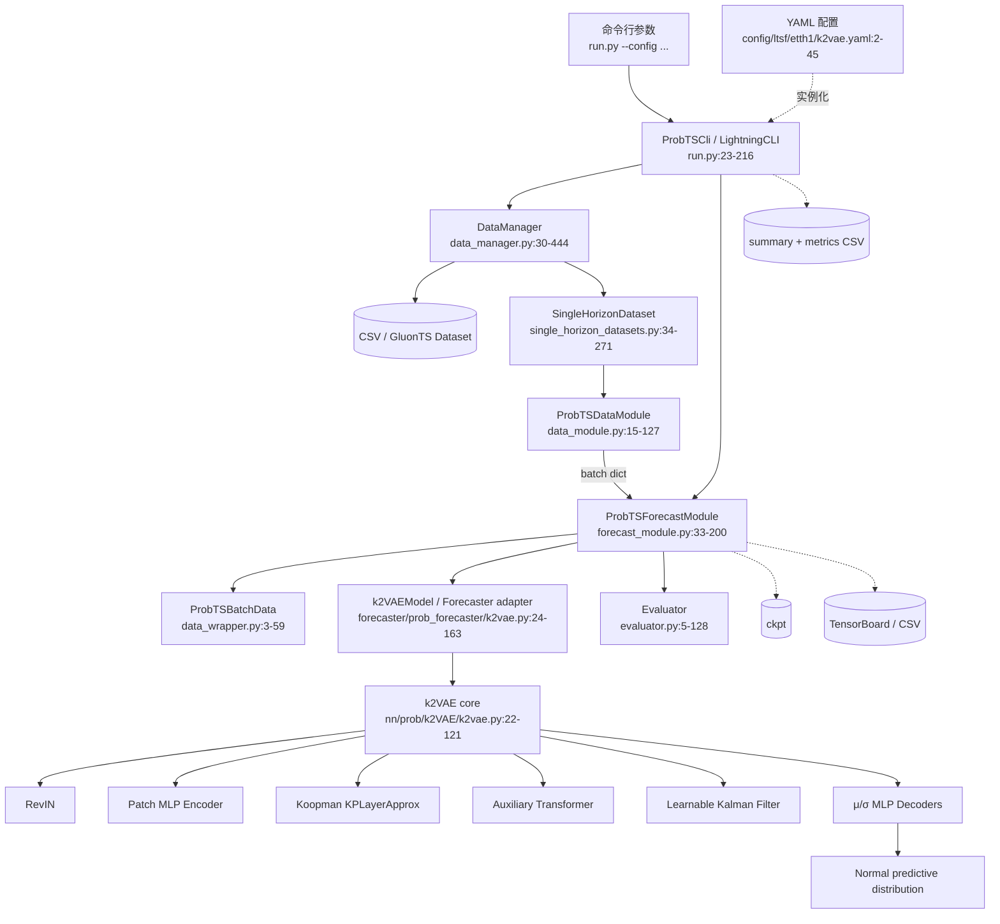
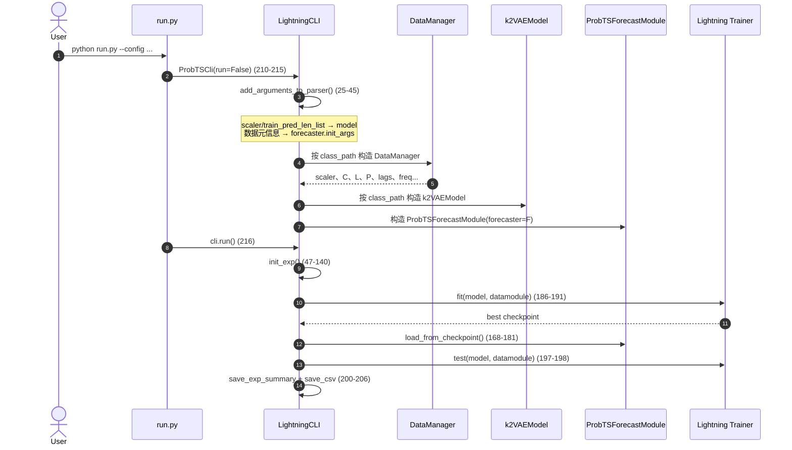
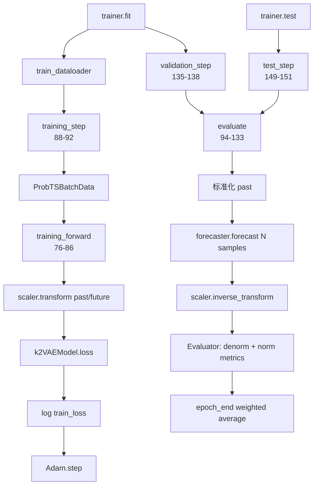
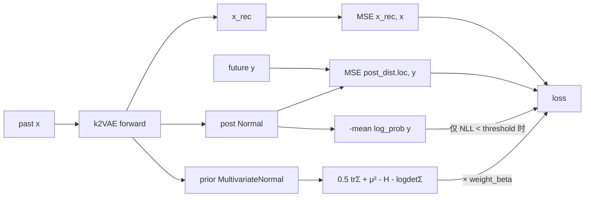
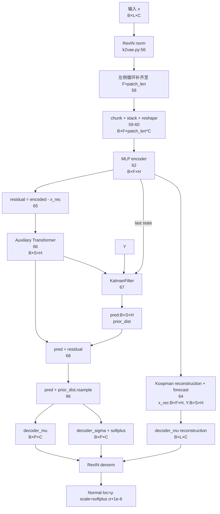
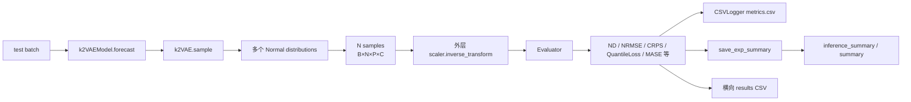
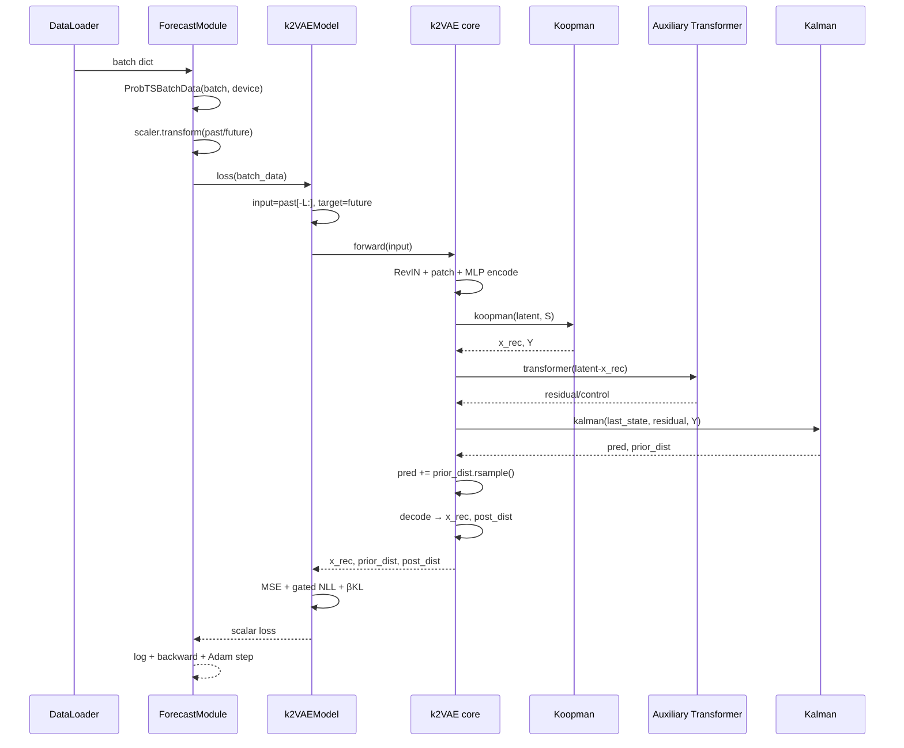

# K²VAE 代码框架与逐行调用图

> 源码快照：2026-10-04  
> 覆盖范围：`python run.py --config config/ltsf/etth1/k2vae.yaml ...` 所触发的 K²VAE 单预测长度训练、验证、测试和结果保存主路径。  
> 行号规则：表格中的 `文件:起始-结束` 对应当前工作区；以后修改源码会导致行号漂移。空行、注释和单纯 import 不作为独立运行步骤，但仍包含在所属代码段范围内。

可直接打开的总览图见 [`K2VAE_ARCHITECTURE.svg`](K2VAE_ARCHITECTURE.svg)。

## 0. 图例与张量符号

| 符号 | 含义 |
|---|---|
| `B` | batch size |
| `L` | context length，历史窗口长度 |
| `P` | prediction length，预测窗口长度 |
| `C` | target dimension，变量数 |
| `F=ceil(L/patch_len)` | 历史 patch 数 |
| `S=ceil(P/patch_len)` | 未来 patch 数 |
| `H=dynamic_dim` | Koopman/Kalman 潜状态维度 |
| `N=num_samples` | 每条序列生成的概率样本数 |
| 实线箭头 | 当前主路径的直接调用或数据传递 |
| 虚线箭头 | 配置注入、日志、checkpoint 或可选分支 |

---

## 1. 全局组件框架



框架分工：

1. `run.py` 只负责编排实验，不实现模型数学。
2. `DataManager` 将原始时间序列变成 GluonTS 数据集并创建滑动窗口。
3. `ProbTSDataModule` 将 iterable dataset 包装成 PyTorch `DataLoader`。
4. `ProbTSForecastModule` 实现 Lightning 生命周期、标准化、指标和优化器。
5. `k2VAEModel` 把 K²VAE 适配到 ProbTS 的 `loss/forecast` 接口。
6. `k2VAE` 实现论文的 Koopman–Kalman VAE 核心。

---

## 2. 启动、配置注入与实验编排



### 2.1 `run.py` 可执行段逐行映射

| 行号 | 操作 | 结果/去向 |
|---|---|---|
| `run.py:13` | 定义只允许多 horizon 的模型白名单 | K²VAE 不在其中，因此当前 K²VAE 主路径是单 horizon |
| `run.py:15-21` | 忽略 warning、设置高精度 matmul、初始化日志 | 全局运行环境 |
| `run.py:23-25` | 声明 `ProbTSCli` 并进入参数注册 | 扩展 LightningCLI |
| `run.py:26-29` | 列出数据层传给 LightningModule 的参数 | `scaler`、`train_pred_len_list` |
| `run.py:30-41` | 列出数据层传给 forecaster 的元信息 | `target_dim/history_length/context_length/...` |
| `run.py:42-45` | `parser.link_arguments(..., apply_on="instantiate")` | 保证数据对象先产生元信息，再注入模型构造器 |
| `run.py:47-51` | 重解析配置、保存模型参数文本、生成时间戳 ID | 建立唯一实验名 |
| `run.py:53-65` | 多 horizon 命名分支与模型白名单检查 | K²VAE 正常不会进入 |
| `run.py:66-74` | 单 horizon 实验名 | `{dataset}_{model}_CTX{L}_PRED{P}_seed...` |
| `run.py:76-83` | 创建根输出目录和本次实验目录 | `self.save_dict` |
| `run.py:85-106` | 若指定预训练 checkpoint，解析路径并恢复模型 | 覆盖 CLI 初始构造的 model |
| `run.py:108-115` | 构造内存和时间 callback | 加入 trainer callbacks |
| `run.py:117-125` | 根据数据/权重策略选择 checkpoint 监控指标 | `train_loss`、`val_CRPS` 或 `val_weighted_ND` |
| `run.py:127-138` | 配置 `ModelCheckpoint` | 每 epoch 保存、保留 last |
| `run.py:140` | 安装自定义 callbacks | 调用 `set_callbacks` |
| `run.py:142-152` | 去重并替换同名 callback，记录 ModelSummary | trainer 回调列表生效 |
| `run.py:154-159` | fit 阶段启用 TensorBoardLogger | 写训练日志 |
| `run.py:161-166` | test 阶段启用 CSVLogger | 写测试指标 |
| `run.py:168-181` | 训练模式下读取 best checkpoint | 测试使用最优权重 |
| `run.py:183-184` | `run()` 首先初始化实验 | 创建目录/callback |
| `run.py:186-195` | 有训练则 `trainer.fit`，否则标记纯推理 | Lightning 接管 epoch/batch 循环 |
| `run.py:197-198` | 切 test logger 并 `trainer.test` | 触发测试生命周期 |
| `run.py:200-206` | 保存实验摘要与横向结果 CSV | 输出最终产物 |
| `run.py:209-216` | 程序入口：绑定 DataModule/LightningModule，禁止 CLI 自动运行，再手动 `run` | 完整流程入口 |

### 2.2 YAML 到对象的映射

| 配置行号 | 配置 | 代码消费者 |
|---|---|---|
| `config/ltsf/etth1/k2vae.yaml:2` | 随机种子 | LightningCLI |
| `:3-14` | GPU、epoch、batch 限制、梯度裁剪、结果目录 | Lightning `Trainer` |
| `:17` | `k2VAEModel` 的 class path | `run.py:210-215` 动态实例化 |
| `:19-33` | Transformer、patch、潜空间、采样参数 | `k2vae.py(adapter):25-71` → core `k2vae.py:23-52` |
| `:34-36` | 样本数、学习率、分位点数 | `forecast_module.py:34-70` |
| `:39` | `DataManager` class path | `ProbTSDataModule` 构造参数 |
| `:41-42` | 验证集与 standard scaler | `data_manager.py:31-165` |
| `:43-45` | train/test batch size 与 worker 数 | `data_module.py:19-35` |

`dataset/path/context_length/prediction_length` 没写死在该 YAML 中，必须通过命令行补入；README 的典型方式是：

```bash
python run.py --config config/ltsf/etth1/k2vae.yaml \
  --data.data_manager.init_args.path ./dataset \
  --data.data_manager.init_args.dataset etth1 \
  --data.data_manager.init_args.context_length 96 \
  --data.data_manager.init_args.prediction_length 96
```

---

## 3. 数据准备、切窗与 batch 构造

```mermaid
flowchart LR
    A[DataManager.__init__<br/>31-165] --> B{数据集类型}
    B -->|GIFT-Eval| G[_load_gift_eval_dataset<br/>175-198]
    B -->|GluonTS 短期| S[_load_short_term_dataset<br/>199-220]
    B -->|CSV 长期/自定义| L[_load_long_term_dataset<br/>239-253]

    L --> I[get_dataset_info + load_dataset<br/>239-250]
    I --> R[get_dataset_borders<br/>247-250]
    R --> M[_set_meta_parameters_from_raw<br/>255-274]
    M --> P[prepare_dataset<br/>276-309]
    P --> FIT[scaler.fit(train only)<br/>284]
    FIT --> MV[df_to_mvds + MultivariateGrouper<br/>287-296]
    MV --> SH[_prepare_single_horizon_datasets<br/>350-375]
    SH --> DS[SingleHorizonDataset]
    DS --> TR[Transformation pipeline<br/>95-150]
    TR --> SP[InstanceSplitter<br/>152-199]
    SP --> IT[TransformedIterableDataset<br/>243-271]
    IT --> DL[DataLoader<br/>data_module.py:37-73]
    DL --> BD[ProbTSBatchData<br/>data_wrapper.py:15-59]
```

### 3.1 `DataManager` 行号映射

| 行号 | 操作 |
|---|---|
| `data_manager.py:31-119` | 声明数据源、窗口、滚动测试、缩放、多变量等参数，并写入实例字段 |
| `data_manager.py:120-165` | 初始化长度列表、选择 scaler、按数据集类型触发实际加载、打印最终配置 |
| `data_manager.py:167-173` | 将字符串映射成 `StandardScaler`、`TemporalScaler` 或 `IdentityScaler` |
| `data_manager.py:175-198` | GIFT-Eval 专用加载分支 |
| `data_manager.py:199-220` | GluonTS repository 短期数据分支并设置元信息 |
| `data_manager.py:221-237` | 将 context/prediction 配成列表并判定 `multi_hor` |
| `data_manager.py:239-253` | 长期 CSV：检查 L/P、解析文件信息、加载 dataframe、划分 border |
| `data_manager.py:255-274` | 计算 lag、history length、目标维度和滚动步长 |
| `data_manager.py:276-282` | 按 border 截取 train/val/test 前缀 |
| `data_manager.py:284` | **只用训练段拟合 scaler，避免测试泄漏** |
| `data_manager.py:287-296` | dataframe → GluonTS multivariate dataset → grouped dataset |
| `data_manager.py:298-303` | 选择 multi/single horizon builder |
| `data_manager.py:305-309` | 创建训练 iterable dataset，并保存时间特征维度与全局均值 |
| `data_manager.py:311-348` | 多 horizon 验证/测试滚动窗口分支（K²VAE 当前不走） |
| `data_manager.py:350-375` | 单 horizon：创建 loader、滚动 val/test、构造 iterable dataset |
| `data_manager.py:377-425` | 短期 GluonTS 数据的 train/val/test 准备 |
| `data_manager.py:427-444` | 打印配置以及数据集类型判断属性 |

### 3.2 Dataset → DataLoader → Batch

| 文件与行号 | 操作 |
|---|---|
| `single_horizon_datasets.py:34-69` | 保存频率、窗口长度、多变量和采样设置 |
| `single_horizon_datasets.py:71-93` | 按 train/val/test 选择 expected-instances、validation 或 test sampler |
| `single_horizon_datasets.py:95-150` | 构建字段移除、observed indicator、time/age feature、维度转换链 |
| `single_horizon_datasets.py:152-199` | 构建 `InstanceSplitter`，产生 past/future target、time feat、observed mask |
| `single_horizon_datasets.py:201-241` | 将 transformation 与 splitter 组合为 iterable dataset |
| `single_horizon_datasets.py:243-271` | iterator 中逐条执行 transform 并输出实例 |
| `data_module.py:19-35` | 接收 DataManager 并缓存 train/val/test datasets |
| `data_module.py:37-53` | 单 horizon 训练 DataLoader：batch、workers、pin memory |
| `data_module.py:55-64` | 空验证集或普通验证 DataLoader |
| `data_module.py:66-70` | 测试 DataLoader |
| `data_module.py:72-73` | 预测 DataLoader |
| `data_module.py:75-81` | 多 horizon 时使用 `CombinedLoader`（当前旁路） |
| `data_module.py:83-127` | 多 horizon 训练时对不同 L/P 做 padding（当前旁路） |
| `data_wrapper.py:15-32` | dict 字段变属性、转 tensor、补默认 context/prediction length |
| `data_wrapper.py:34-38` | 检查所有必需输入字段存在 |
| `data_wrapper.py:40-45` | tensor 移至当前 Lightning device |
| `data_wrapper.py:47-51` | 必要时补 batch/feature 维度 |
| `data_wrapper.py:53-59` | 根据 `past_is_pad` 处理 padding 对应的 observed mask |

单 horizon K²VAE 实际用到的核心张量：

```text
past_target_cdf   : [B, history_length, C]
future_target_cdf : [B, P, C]
k2VAE 输入         : past_target_cdf[:, -L:, :] = [B, L, C]
```

---

## 4. Lightning 训练、验证与测试



### 4.1 `ProbTSForecastModule` 行号映射

| 行号 | 操作 |
|---|---|
| `forecast_module.py:16-30` | 为多 horizon loss 构造 random/const/none 权重 |
| `forecast_module.py:34-70` | 保存 forecaster、scaler、采样数、学习率、Evaluator 和 checkpoint 超参数 |
| `forecast_module.py:72-74` | 委托 `save_utils.load_checkpoint` 恢复对象和 state dict |
| `forecast_module.py:76-79` | 训练前标准化 past 与 future |
| `forecast_module.py:80-86` | 调用 `forecaster.loss`；必要时按 horizon 加权归约 |
| `forecast_module.py:88-92` | batch dict → `ProbTSBatchData` → loss → Lightning log |
| `forecast_module.py:94-99` | 评估时保存预测长度和原始 past/future |
| `forecast_module.py:101-107` | 构造标准化副本，记录 batch size，生成 `N` 条 forecast samples |
| `forecast_module.py:109-116` | 反标准化预测；分别计算原尺度与标准化尺度指标 |
| `forecast_module.py:118-127` | 为非测试多 horizon 指标设置权重；测试时按 horizon 汇总 |
| `forecast_module.py:129-133` | 返回本 batch 指标 |
| `forecast_module.py:135-147` | validation step/start/end：清空容器并按 batch size 加权汇总 |
| `forecast_module.py:149-169` | test step/start/end：汇总总体和每 horizon 指标并记录 |
| `forecast_module.py:171-174` | predict step：直接返回概率样本 |
| `forecast_module.py:176-183` | 无自定义配置时创建 Adam |
| `forecast_module.py:184-200` | 可选动态 optimizer/scheduler；scheduler 按 epoch 监听 `val_loss` |

### 4.2 训练损失精确组成



对应 `forecaster/prob_forecaster/k2vae.py`：

| 行号 | 数学/操作 |
|---|---|
| `88-113` | 从 `prior_dist` 取 `μ,Σ`，计算每时间步 KL，再对时间和 batch 求均值 |
| `115-126` | 取最后 L 个 past，取 future target，执行 forward |
| `127` | `rec_loss = MSE(reconstruction,input) + MSE(predictive_mean,target)` |
| `128` | `post_loss = -E[log p(target)]` |
| `129` | 计算 latent Gaussian 对标准正态的 KL 项 |
| `130` | 当 NLL 超过阈值时将其临时关闭以稳定训练 |
| `132` | `loss = rec_loss + α*post_loss + β*kld_loss` |

---

## 5. K²VAE 核心前向传播与形状



### 5.1 Adapter：`k2VAEModel`

| 行号 | 操作 |
|---|---|
| `forecaster/prob_forecaster/k2vae.py:25-51` | 接收 K²VAE 专属超参数以及 CLI 注入的 `**kwargs` |
| `:52` | 调用 `Forecaster.__init__`，得到 L/P/C/freq/input_size |
| `:54-70` | 将离散参数和数据元信息写成底层 config |
| `:72` | 创建 `self.model = k2VAE(config)` |
| `:74-86` | `forward` 原样返回 reconstruction、prior、posterior |
| `:88-113` | KL 计算 |
| `:115-137` | 训练损失 |
| `:139-141` | 将 core 输出从 `[N,B,P,C]` 重排成 `[B,N,P,C]` |
| `:143-163` | forecast：取最后 L 步、eval/no_grad、按 N 采样 |

### 5.2 Core 初始化与 forward：`nn/prob/k2VAE/k2vae.py`

| 行号 | 操作 |
|---|---|
| `23-32` | 保存 L/P/patch/潜维度/MLP 层数/变量数 |
| `34-37` | 计算 F、S、padding，并按 `multistep` 选 Koopman 实现 |
| `39` | 创建可学习 `KalmanFilter(H)` |
| `41` | 创建 Auxiliary Transformer |
| `43-48` | 创建 patch encoder、均值 decoder、尺度 decoder |
| `50` | 创建 RevIN |
| `54-62` | norm → padding → patch → latent encoding |
| `64-68` | Koopman → residual → Transformer → Kalman → residual correction |
| `72-78` | 解码历史 latent reconstruction，并裁剪到 L |
| `80-89` | 分别解码预测均值和尺度，并裁剪到 P |
| `91-93` | RevIN 反归一化三个输出 |
| `95` | 创建最终逐点 Normal 分布 |
| `98-103` | forward：encode，重参数采样噪声加到 latent prediction，再 decode |
| `105-111` | sample：先 encode，再为每个 schedule 构造随机 latent 并 decode |
| `113-121` | 将 N 分配给各 schedule distribution，采样后沿样本轴拼接 |

---

## 6. Koopman、辅助 Transformer 与 Kalman 细图

```mermaid
flowchart LR
    Z[z:B×F×H] --> XY[x=z[:-1], y=z[1:]]
    XY --> MODE{init_koopman}
    MODE -->|static| LS[K=lstsq(x,y)]
    MODE -->|dynamic| KD[K=learnable orthogonal K_dynamic]
    MODE -->|both| BOTH[K=lstsq + K_dynamic]
    LS --> KR[z_rec = z0 concat xK]
    KD --> KR
    BOTH --> KR
    KR --> MP[K_step = matrix_power K]
    MP --> ZP[z_pred:B×S×H]
    Z --> RES[residual=z-z_rec]
    RES --> ADAPT[Linear H→d_model]
    ADAPT --> ATTN[Full self-attention encoder]
    ATTN --> HEAD[Flatten + Linear → S×H]
    HEAD --> U[Kalman control U_t]
    ZP --> Y[Kalman observation Y_t]
    Z --> X0[last latent state]
    X0 --> KF[Kalman recurrence]
    U --> KF
    Y --> KF
```

### 6.1 Koopman 映射

| 行号 | 操作 |
|---|---|
| `koopman.py:13-50` | 通用 MLP：Linear/activation/dropout 堆叠，用于 encoder/decoder |
| `koopman.py:54-100` | 单步 `KPLayer`：估计 K、重建历史并逐步乘 K 外推 |
| `koopman.py:102-115` | `KPLayerApprox` 初始化；dynamic 模式用 SVD 得到近似正交 K |
| `koopman.py:117-130` | 分离相邻 latent snapshots，根据模式得到 K |
| `koopman.py:132-134` | K 出现 NaN 时用单位阵兜底 |
| `koopman.py:136` | `z_rec = [z0, xK]` |
| `koopman.py:138-155` | 用 `matrix_power` 做多步近似；P 较长时分块外推并裁剪 |

### 6.2 Auxiliary Transformer 映射

| 行号 | 操作 |
|---|---|
| `auxiliarynet.py:18-22` | 保存 L/P |
| `auxiliarynet.py:24-45` | 建立 `e_layers` 个 FullAttention EncoderLayer + LayerNorm |
| `auxiliarynet.py:47` | latent H → attention d_model |
| `auxiliarynet.py:50-51` | `(F*d_model) → (S*H)` prediction head |
| `auxiliarynet.py:55-59` | adaptation 后执行 self-attention encoder |
| `auxiliarynet.py:62-64` | flatten、head、reshape 成 `[B,S,H]` residual/control |
| `Transformer_EncDec.py:26-50` | EncoderLayer：self-attention residual + norm + 1×1 Conv FFN residual + norm |
| `Transformer_EncDec.py:53-79` | Encoder：逐层调用并收集 attention，最后 norm |
| `SelfAttention_Family.py:48-75` | FullAttention：`QKᵀ` → mask(optional) → softmax/dropout → 加权 V |
| `SelfAttention_Family.py:179-213` | AttentionLayer：Q/K/V 线性投影、多头 reshape、输出投影 |

### 6.3 Kalman 单步递推

```mermaid
flowchart TD
    P0[P₀=I] --> LOOP[对 t=0..S-1]
    LOOP --> QR[Q=LQ·LQᵀ, R=LR·LRᵀ]
    QR --> XP[x_pred = x_prev Fᵀ + u Bᵀ]
    XP --> PP[P_pred = F P Fᵀ + Q]
    PP --> INNOV[S = H P_pred Hᵀ + R]
    INNOV --> GAIN[K = P_pred Hᵀ S⁻¹]
    GAIN --> XU[x = x_pred + K innovation]
    XU --> JOSEPH[P = (I-KH)P_pred(I-KH)ᵀ + KRKᵀ]
    JOSEPH --> SYM[P = 0.5(P+Pᵀ)]
    SYM --> LOOP
    LOOP --> MVN[MultivariateNormal zero mean, covariance=P sequence]
```

| 行号 | 操作 |
|---|---|
| `kalman.py:15-36` | 初始化 B/F/H 以及 Cholesky 风格参数 LQ/LR |
| `kalman.py:38-51` | `Q=LQ LQᵀ`、`R=LR LRᵀ` 并扩展 batch |
| `kalman.py:53-69` | 单步预测 state 和 covariance |
| `kalman.py:71-78` | innovation covariance、逆矩阵、Kalman gain、measurement update |
| `kalman.py:80-89` | Joseph 稳定形式更新 covariance |
| `kalman.py:92-107` | 异常时通过特征值截断修复正定性 |
| `kalman.py:109-128` | 初始化 P=I，循环 S 个未来 patch，收集 state/covariance |
| `kalman.py:130-140` | stack；建立零均值 latent noise 分布，失败时先修复 covariance |

### 6.4 RevIN 映射

| 行号 | 操作 |
|---|---|
| `RevIN.py:6-18` | 保存 epsilon/affine/subtract_last 并初始化通道仿射参数 |
| `RevIN.py:20-28` | `norm` 先统计再归一化；`denorm` 执行逆变换 |
| `RevIN.py:30-33` | 每变量可学习 weight/bias |
| `RevIN.py:35-41` | 沿时间维求 detached mean/variance，或记录最后值 |
| `RevIN.py:43-52` | 中心化、除标准差、应用 affine |
| `RevIN.py:54-63` | 逆 affine、乘标准差、恢复 mean/last |

---

## 7. 概率采样、评估与结果产物



| 文件与行号 | 操作 |
|---|---|
| `core k2vae.py:101-121` | schedule 次扰动 latent；按份额采样凑足 N；输出 `[N,B,P,C]` |
| `adapter k2vae.py:139-141` | 重排为统一接口 `[B,N,P,C]` |
| `forecast_module.py:94-133` | 反标准化并分别计算原尺度、标准化尺度与 horizon 指标 |
| `evaluator.py:21-68` | sequence metrics：均值预测误差、分位点损失、coverage、CRPS 等 |
| `evaluator.py:70-91` | 汇总成标量 metric 字典 |
| `evaluator.py:93-128` | 选择指标；基于历史和频率计算 seasonal error 后评估 |
| `save_utils.py:11-39` | metric 累积、普通平均和 batch-size 加权平均 |
| `save_utils.py:53-92` | 可信 Lightning checkpoint：恢复超参数、覆盖运行参数、load state dict |
| `save_utils.py:94-102` | 生成 horizon 标识 |
| `save_utils.py:104-131` | 保存实验参数、时间、内存和平均指标摘要 |
| `save_utils.py:133-154` | 将模型参数与指标写入实验 CSV |

典型输出目录：

```text
results/<dataset>_<model>_CTX<L>_PRED<P>_seed.../
├── ckpt/
│   ├── epoch=<n>-val_CRPS=<value>.ckpt
│   └── last.ckpt
├── logs/
│   └── <tag>/
│       ├── fit/        # TensorBoard
│       └── test/       # CSVLogger + metrics.csv
└── inference_summary.json / 汇总 CSV
```

---

## 8. 一次训练 batch 的端到端代码追踪



严格调用顺序索引：

1. `data_module.py:37-53`
2. `forecast_module.py:88-92`
3. `data_wrapper.py:15-59`
4. `forecast_module.py:76-86`
5. `forecaster/prob_forecaster/k2vae.py:115-137`
6. `forecaster/prob_forecaster/k2vae.py:74-86`
7. `nn/prob/k2VAE/k2vae.py:93-99`
8. `nn/prob/k2VAE/k2vae.py:54-70`
9. `nn/prob/k2VAE/koopman.py:117-155`
10. `nn/prob/k2VAE/auxiliarynet.py:55-66`
11. `nn/prob/k2VAE/kalman.py:109-140`
12. `nn/prob/k2VAE/k2vae.py:72-91`
13. `forecaster/prob_forecaster/k2vae.py:127-132`
14. `forecast_module.py:91-92`
15. `forecast_module.py:176-200`

---

## 9. 文件责任索引（搜索入口）

| 文件 | 主责任 | 首读位置 |
|---|---|---|
| [`run.py`](run.py) | 实验生命周期与 CLI | `23`, `47`, `183`, `209` |
| [`config/ltsf/etth1/k2vae.yaml`](config/ltsf/etth1/k2vae.yaml) | ETTh1 K²VAE 配置 | `2-45` |
| [`probts/data/data_manager.py`](probts/data/data_manager.py) | 数据源、划分、缩放、窗口元信息 | `30`, `239`, `276`, `350` |
| [`probts/data/datasets/single_horizon_datasets.py`](probts/data/datasets/single_horizon_datasets.py) | GluonTS transformation/instance split | `34`, `95`, `152`, `201` |
| [`probts/data/data_module.py`](probts/data/data_module.py) | DataLoader | `15`, `37`, `55`, `66` |
| [`probts/data/data_wrapper.py`](probts/data/data_wrapper.py) | batch 字段规范化与 device | `3`, `15` |
| [`probts/model/forecast_module.py`](probts/model/forecast_module.py) | Lightning 训练/评估/优化器 | `33`, `76`, `88`, `94`, `176` |
| [`probts/model/forecaster/forecaster.py`](probts/model/forecaster/forecaster.py) | 所有 forecaster 的统一接口 | `9`, `77`, `184` |
| [`probts/model/forecaster/prob_forecaster/k2vae.py`](probts/model/forecaster/prob_forecaster/k2vae.py) | K²VAE adapter、loss、forecast | `24`, `88`, `115`, `143` |
| [`probts/model/nn/prob/k2VAE/k2vae.py`](probts/model/nn/prob/k2VAE/k2vae.py) | 核心模型、encode/decode/sample | `22`, `54`, `72`, `93`, `101` |
| [`probts/model/nn/prob/k2VAE/koopman.py`](probts/model/nn/prob/k2VAE/koopman.py) | MLP 与 Koopman 动力学 | `13`, `54`, `102` |
| [`probts/model/nn/prob/k2VAE/auxiliarynet.py`](probts/model/nn/prob/k2VAE/auxiliarynet.py) | residual Transformer | `17`, `55` |
| [`probts/model/nn/prob/k2VAE/kalman.py`](probts/model/nn/prob/k2VAE/kalman.py) | 可学习 Kalman filter | `14`, `53`, `109` |
| [`probts/model/nn/prob/k2VAE/RevIN.py`](probts/model/nn/prob/k2VAE/RevIN.py) | 可逆实例归一化 | `5`, `20`, `35`, `43`, `54` |
| [`probts/model/nn/prob/k2VAE/SelfAttention_Family.py`](probts/model/nn/prob/k2VAE/SelfAttention_Family.py) | attention 数学 | `48`, `179` |
| [`probts/model/nn/prob/k2VAE/Transformer_EncDec.py`](probts/model/nn/prob/k2VAE/Transformer_EncDec.py) | Transformer encoder layer | `26`, `53` |
| [`probts/utils/evaluator.py`](probts/utils/evaluator.py) | 概率预测指标 | `5`, `21`, `70`, `96` |
| [`probts/utils/save_utils.py`](probts/utils/save_utils.py) | checkpoint 与结果保存 | `53`, `104`, `133` |

## 10. 当前实现中需要特别注意的边界

- K²VAE adapter 直接使用 `past_target_cdf`，没有走基类 `Forecaster.get_inputs()` 的 lag/time-feature 拼接逻辑。
- YAML 的 `multistep: true` 选择 `KPLayerApprox`，不是逐步调用普通 `KPLayer`。
- core 内有一次 RevIN，外层 `ForecastModule` 还有 dataset scaler；二者作用层级不同。
- Kalman 返回的 `prior_dist.loc` 是零张量，state prediction 与 prior noise 在 core 的 `forward` 中相加。
- `sample()` 会重新对多个随机 latent 解码；预测样本最终统一成 `[B,N,P,C]`。
- `MULTI_HOR_MODEL` 白名单没有 K²VAE，因此多 horizon 数据路径虽然存在于框架中，但不是当前 K²VAE 可执行主路径。
- 本文覆盖 K²VAE 直接依赖。`probts/model/forecaster` 中其他 point/probabilistic baselines、`config/tsfm` 和 `config/m4` 不参与这里展示的一次 K²VAE ETTh1 运行。
